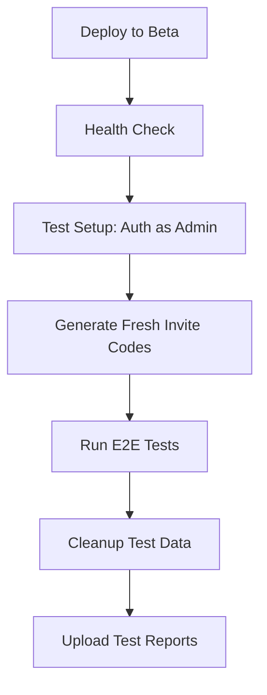

# Beta E2E Testing Setup Guide

This guide explains how to configure your GitHub repository for automated E2E testing against the deployed beta environment.

## Overview

The beta E2E tests run automatically after each deployment to beta. They test the complete application flow including:
- User signup with dynamically generated invite codes
- Viral invite code flow (User A invites User B)
- User account deletion
- Invite code reuse prevention
- Error handling

## Key Innovation: Dynamic Invite Code Generation

**Problem**: Invite codes are single-use, so pre-seeded codes get consumed and tests fail.

**Solution**: Tests authenticate as PocketBase admin and generate fresh invite codes before each run!

**Benefits**:
- ✅ No manual invite code creation
- ✅ Tests always have fresh codes
- ✅ Automatic cleanup of test data
- ✅ No risk of running out of codes

## Setup Instructions

### Step 1: Create PocketBase Admin Account

1. Access your beta PocketBase admin panel:
   ```
   https://beta.myexperiment.life/_/
   ```

2. Login or create an admin account if you haven't already

3. Note down:
   - Admin email
   - Admin password

### Step 2: Configure GitHub Secrets

1. Go to your GitHub repository

2. Navigate to: **Settings** → **Secrets and variables** → **Actions**

3. Click **"New repository secret"**

4. Add the first secret:
   - **Name**: `BETA_ADMIN_EMAIL`
   - **Value**: Your PocketBase admin email (e.g., `admin@example.com`)
   - Click **"Add secret"**

5. Add the second secret:
   - **Name**: `BETA_ADMIN_PASSWORD`
   - **Value**: Your PocketBase admin password
   - Click **"Add secret"**

### Step 3: Verify Workflow Configuration

The workflow is already configured! Check `.github/workflows/deploy.yml`:

```yaml
- name: Run beta E2E tests
  run: |
    cd frontend
    npm run test:e2e:beta
  env:
    CI: true
    BETA_ADMIN_EMAIL: ${{ secrets.BETA_ADMIN_EMAIL }}
    BETA_ADMIN_PASSWORD: ${{ secrets.BETA_ADMIN_PASSWORD }}
```

### Step 4: Deploy and Test

1. Push to `main` branch or manually trigger the workflow

2. The workflow will:
   - ✅ Run local build validation tests
   - ✅ Deploy to beta environment
   - ✅ Run health check
   - ✅ **Authenticate as PocketBase admin**
   - ✅ **Generate fresh invite codes**
   - ✅ **Run all E2E tests**
   - ✅ **Clean up test data**
   - ✅ Upload test reports

## How It Works

### Test Flow Architecture



### Dynamic Code Generation

The test setup (`frontend/e2e/helpers/beta-setup.ts`) performs:

1. **Authentication** (using [official PocketBase docs](https://pocketbase.io/docs/authentication/)):
   ```typescript
   // Authenticate as superuser using _superusers collection
   await pb.collection('_superusers').authWithPassword(adminEmail, adminPassword);
   ```

   This gives us full admin privileges to bypass API rules and manage test data.

2. **Code Generation**:
   ```typescript
   await pb.collection('invite_codes').create({
     code: generateInviteCode(),
     used: false,
   });
   ```

3. **Cleanup**:
   ```typescript
   await cleanupBetaTestData(pb, inviteCode);
   ```

### Test Scenarios

#### 1. Viral Network Flow (Complete Flow)
```
User A signs up → Gets invite codes → Logs out
→ User B signs up with A's code → B deletes account
→ A logs back in → Verifies code marked as "Used"
→ A deletes account → Cleanup
```

#### 2. Invite Code Reuse Prevention
```
Create code → Mark as used → Attempt signup
→ Verify rejection with error message
```

#### 3. Fake Invite Code Rejection
```
Generate random fake code → Attempt signup
→ Verify rejection with error message
```

## Troubleshooting

### Issue: "Beta admin credentials not configured"

**Cause**: GitHub secrets not set or named incorrectly

**Solution**:
1. Verify secrets exist: Settings → Secrets and variables → Actions
2. Check exact names: `BETA_ADMIN_EMAIL` and `BETA_ADMIN_PASSWORD`
3. Ensure no typos or extra spaces

### Issue: "Authentication failed"

**Cause**: Invalid admin credentials

**Solution**:
1. Login to beta admin panel manually: `https://beta.myexperiment.life/_/`
2. Verify your admin email and password work
3. Update GitHub secrets with correct credentials

### Issue: Tests fail with "invite code not found"

**Cause**: Code generation failed or network issues

**Solution**:
1. Check GitHub Actions logs for error messages
2. Verify beta environment is accessible
3. Ensure PocketBase admin API is working

### Issue: Tests leave behind test data

**Cause**: Test cleanup failed (test crashed or timeout)

**Solution**:
1. Manually clean up via PocketBase admin UI:
   - Go to `users` collection
   - Filter by: `email ~ "test-"`
   - Delete test users
2. Go to `invite_codes` collection
   - Filter by: `code ~ "TEST"`
   - Delete test codes

## Local Testing

For local development, tests automatically skip beta-specific scenarios:

```bash
cd frontend
npm run test:e2e:local  # Skips backend-dependent tests
```

To test the beta setup locally:

```bash
# Set environment variables
export BETA_ADMIN_EMAIL=your-admin@example.com
export BETA_ADMIN_PASSWORD=your-password

# Run beta tests
npm run test:e2e:beta
```

## Security Considerations

### Admin Credentials

- ✅ Stored securely as GitHub encrypted secrets
- ✅ Never logged or exposed in test output
- ✅ Only accessible to GitHub Actions workflows
- ✅ Can be rotated anytime without code changes

### Test Data Isolation

- ✅ Test users have identifiable email pattern (`test-{timestamp}@example.com`)
- ✅ Test invite codes have identifiable prefix (`TEST{timestamp}`)
- ✅ All test data is automatically cleaned up
- ✅ Tests don't interfere with real user data

## Monitoring Test Results

### View Test Reports

1. Go to GitHub Actions → Your workflow run
2. Scroll to "Artifacts" section
3. Download `playwright-report-beta`
4. Extract and open `index.html` in browser

### View Test Summary

GitHub Actions automatically shows:
- ✅ Number of tests passed/failed
- ✅ Test duration
- ✅ Screenshots of failures
- ✅ Detailed error messages

## Production Deployment Gate

Beta tests act as a quality gate for production:

```
Push to main → Local tests → Deploy to beta
→ Beta E2E tests (must pass)
→ Manual production deployment (if beta tests pass)
```

Production deployment is **blocked** if beta tests fail!

## Related Documentation

- [E2E Testing README](frontend/e2e/README.md) - Detailed test documentation
- [Test Environment Helpers](frontend/e2e/helpers/test-environment.ts) - Environment detection
- [Beta Setup Helpers](frontend/e2e/helpers/beta-setup.ts) - Dynamic code generation
- [PocketBase Authentication](https://pocketbase.io/docs/authentication/) - Official admin auth docs

## Questions?

If you encounter issues:
1. Check GitHub Actions logs for detailed error messages
2. Verify admin credentials in beta environment
3. Review test reports in artifacts
4. Check PocketBase logs if backend issues suspected

---

**Last Updated**: 2025-10-12
**Status**: ✅ Production Ready
